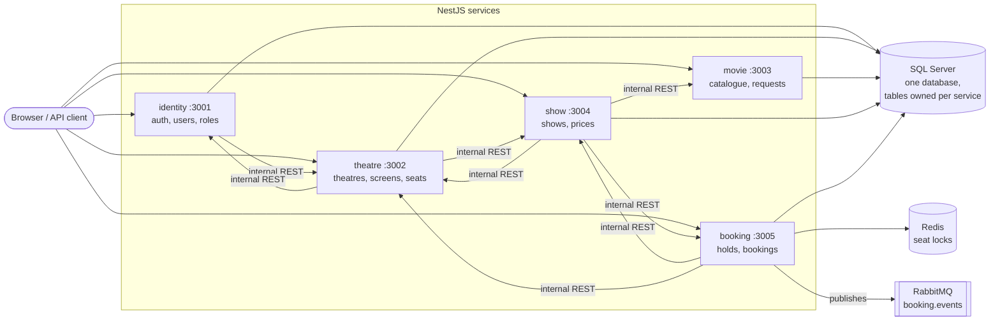
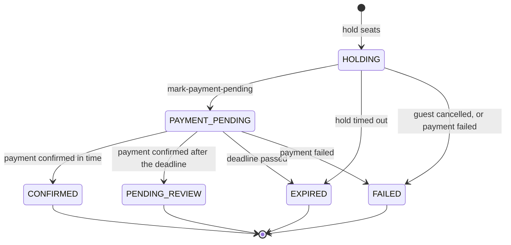

# Movie Ticket Booking System

A NestJS microservices backend for booking cinema seats, built so that one seat can never be sold twice.

[](https://github.com/sachchin06/moviebooking-backend/actions/workflows/ci.yml)
[](LICENSE)

## Overview

Theatre staff set up theatres, screens, seats, movies and shows; guests pick seats and hold them while they pay. Five NestJS services share one SQL Server database, use Redis for seat locks and publish booking events to RabbitMQ. The interesting part is concurrency: many guests can ask for the same seat at the same moment, through any service instance, while Redis may be down. A unique index in the database makes a second live claim on a seat impossible, and integration tests against real SQL Server, Redis and RabbitMQ prove it under load.

## Architecture



| Service | Port | Owns these tables |
|---|---|---|
| identity | 3001 | `roles`, `users` |
| theatre | 3002 | `theatres`, `theatre_admins`, `screens`, `seats` |
| movie | 3003 | `movies`, `movie_images`, `movie_requests` |
| show | 3004 | `shows`, `show_prices` |
| booking | 3005 | `bookings`, `booking_seats`, `seat_holds` |

- **Shared libraries.** `@moviebooking/common` holds service start-up (helmet, CORS, validation, error filter, Swagger), JWT and role guards, the internal API guard, the service-to-service HTTP client and ID encryption. `@moviebooking/database` holds the TypeORM entities, the 11 migrations, the booking state machine's transition table and the seat-conflict repair command.
- **One database.** Every service connects to the same SQL Server database but maps only the tables it owns and never joins another service's tables at runtime.
- **Internal REST.** Services call each other on `/api/internal/*` with an `X-Internal-Key` header. The shared client times out after 2 seconds, returns `null` for a 404 and turns every other failure into 503.
- **Events.** The booking service publishes `booking.confirmed`, `booking.expired` and `booking.failed` to the `booking.events` topic exchange after each transaction commits. Nothing consumes them yet.
- **Redis.** Short-lived seat locks in front of the database, used only by the booking service.

There are 57 public and 20 internal endpoints across the five services. More detail: [docs/architecture.md](docs/architecture.md).

## Service status

| Service | Status | What works | Known gaps | Tests |
|---|---|---|---|---|
| identity | Working | Login, token refresh, password change, admin user management with temporary passwords, roles | Logout does not revoke tokens; no rate limiting on login | 35 unit |
| theatre | Working | Theatres, screens, seats with bulk create and update, theatre-admin assignment; refuses to deactivate anything with future shows | No integration tests | 50 unit |
| movie | Working | Movie catalogue, image URLs with a primary image, movie requests from theatre admins and their review | Images are URLs, there is no file upload; no integration tests | 26 unit |
| show | Working | Show scheduling without overlaps per screen, prices per seat type | No integration tests | 74 unit |
| booking | Working | Seat availability, seat holds, the booking state machine, expiry sweep, internal endpoints for a payment service, events | Nothing calls the payment endpoints yet; events can be lost (no outbox) | 120 unit, 16 integration |
| payment | Not started | | | |
| notification | Not started | | | |
| web-admin | Not started | | | |

## Booking flow

1. `GET /api/shows/:showId/seats/availability` lists every seat as AVAILABLE, HELD or SOLD, with its price.
2. `POST /api/bookings/hold` takes Redis locks on the seats, then in one transaction reclaims expired holds on them, checks they are free, and writes the booking, its seats (with price and seat-code snapshots) and one ACTIVE hold per seat. The guest gets a 10-character booking reference and 5 minutes.
3. A payment service calls `POST /api/internal/bookings/:ref/mark-payment-pending`. The deadline becomes 10 minutes from now, but never more than 15 minutes after the booking was created.
4. `POST /api/internal/bookings/:ref/confirm` confirms the booking, turns its holds into CONVERTED (sold) and publishes `booking.confirmed`.
5. The guest can poll `GET /api/bookings/:ref`, and can cancel with `POST /api/bookings/:ref/cancel` (with their email) while the booking is still HOLDING. A sweep every minute expires anything overdue.



The four end states are final; the transition table lives in `libs/database` and every status change goes through it. Holds have their own states: ACTIVE while reserved, CONVERTED when sold, and EXPIRED or RELEASED when the seat is free again.

## Design decisions

Each has a longer write-up in [docs/adr/](docs/adr/).

**The database index is the real guarantee.** Application checks and Redis locks can both be bypassed by a race, a bug or a second instance. A filtered unique index on `seat_holds (show_id, seat_id) WHERE status IN ('ACTIVE', 'CONVERTED')` makes a second live claim on a seat fail with a duplicate-key error, which the service returns as 422. An integration test fires 20 concurrent holds at one seat with Redis unreachable: one wins. With the index dropped in a mutation run, the same test produced 20 winners. ([ADR 0001](docs/adr/0001-unique-index-on-live-holds.md))

**Redis locks are a fast path that fails open.** Without them, every contested request reaches SQL Server and waits on key locks. Each seat gets `SET lock:seat:<show>:<seat> <nonce> PX 8000 NX`, retried every 50 ms for up to 500 ms, and is released with a compare-and-delete Lua script so a slow request cannot remove someone else's lock. If Redis is down, holds carry on without locks, because the index still protects the seats. ([ADR 0002](docs/adr/0002-redis-locks-fail-open.md))

**Stale holds are reclaimed in the hold request, in a fixed order.** Waiting up to a minute for the sweep would refuse seats that are really free, so a hold request first expires overdue bookings on the seats it wants. Several resources are locked at once, so they are always taken in the same order to avoid deadlocks: Redis locks by seat ID, booking rows by booking ID, a booking before its holds, and new holds inserted by seat ID. The last rule came from an intermittent deadlock in the overlapping-seats test. ([ADR 0003](docs/adr/0003-stale-hold-reclaim-and-lock-ordering.md))

**Show scheduling takes one lock per screen.** Two shows created at once on the same screen can each pass the overlap check. Range locks on the time columns would depend on the index the optimiser picks and could lock far more than one screen, so a create or reschedule first calls `sp_getapplock` on `show-schedule:screen:<id>` inside its transaction. A second change to the same screen waits, then sees the first; a 5-second timeout returns 409. ([ADR 0004](docs/adr/0004-per-screen-applock-for-show-scheduling.md))

**Row locks make cancel and confirm take turns.** A guest cancelling while the payment confirms could leave a paid booking marked as failed. Every transition reads the booking with `pessimistic_write` (`UPDLOCK, ROWLOCK` on SQL Server), checks the state machine, then writes, so the second caller sees the first one's result. An integration test races the two and never finds a confirmed booking overwritten. ([ADR 0005](docs/adr/0005-row-locks-for-booking-transitions.md))

**Fail closed when another service cannot answer.** If "does this show have bookings?" times out and is read as "no", a show with bookings could be deleted. The shared client treats only a 404 as an answer; timeouts, refused connections and other errors become 503, and yes/no checks never default to "no". ([ADR 0006](docs/adr/0006-fail-closed-on-dependency-failure.md))

**Internal routes need a key, compared in constant time.** The internal routes include "confirm this booking", on the same port as the public API. They require `X-Internal-Key` to match `INTERNAL_API_KEY`; both values are hashed with SHA-256 and compared with `crypto.timingSafeEqual`, so neither the timing nor the key length leaks. Every service refuses to start without the key. ([ADR 0007](docs/adr/0007-internal-api-key.md))

**Public IDs are encrypted.** Sequential integer keys in URLs let anyone count records. Public responses carry IDs encrypted with AES-256-GCM (random 12-byte IV, 16-byte tag, base64url). Incoming IDs that do not decrypt, including plain numbers, get 400. Services use plain integers between themselves. ([ADR 0008](docs/adr/0008-encrypted-public-ids.md))

**A late payment goes to PENDING_REVIEW.** A payment can complete after the reservation deadline, when the seats may already be on sale again. Confirming would risk a double sale, and rejecting would keep money for nothing, so the booking moves to PENDING_REVIEW and its holds are released in the same transaction. A person then decides on a refund. ([ADR 0009](docs/adr/0009-late-payment-to-pending-review.md))

**One shared database, for now.** A database per service brings cross-service consistency problems long before a project this size gets the benefits. Each service owns its tables and asks other services over REST rather than joining their tables, and bookings snapshot prices and seat codes, so a later split is possible. Foreign keys do cross ownership lines today, and a migration can affect several services. ([ADR 0010](docs/adr/0010-shared-database.md))

## Tech stack

| Area | Choice |
|---|---|
| Language and runtime | TypeScript 5.9 on Node.js 20+ |
| Framework | NestJS 10, npm workspaces monorepo |
| Database | SQL Server, TypeORM 0.3 with migrations |
| Locks | Redis (ioredis) |
| Messaging | RabbitMQ (`@golevelup/nestjs-rabbitmq`) |
| Auth | JWT access and refresh tokens, bcrypt password hashes |
| Validation and docs | class-validator, Swagger via `@nestjs/swagger` |
| Tests | Jest and ts-jest |
| CI | GitHub Actions |

## Getting started

You need Node.js 20 or later with npm 10, Docker, and a SQL Server instance you can reach (SQL Server is not part of `docker-compose.yml`; a local install or your own container both work).

```bash
npm ci
cp .env.example .env
```

Fill in `.env`. The values without defaults are required:

- `DB_PASSWORD` and the other `DB_*` settings for your SQL Server;
- `JWT_SECRET` and `JWT_REFRESH_SECRET`;
- `ID_ENCRYPTION_KEY`;
- `INTERNAL_API_KEY` (the same value for every service; `.env.example` shows how to generate one);
- `ADMIN_EMAIL` and `ADMIN_PASSWORD` for the first super admin, created by a migration;
- `REDIS_PASSWORD`, `RABBITMQ_USER` and `RABBITMQ_PASSWORD`, which Docker Compose also reads.

Then start Redis and RabbitMQ, build the shared libraries (the services import them from `dist/`), and run the migrations:

```bash
docker compose up -d
npm run build:libs
npm run db:migrate
```

Start each service in its own terminal:

```bash
npm run start:dev -w @moviebooking/identity-service
npm run start:dev -w @moviebooking/theatre-service
npm run start:dev -w @moviebooking/movie-service
npm run start:dev -w @moviebooking/show-service
npm run start:dev -w @moviebooking/booking-service
```

Outside production, each service serves Swagger at `http://localhost:<port>/api/docs`. A Postman collection is in [docs/MovieBooking.postman_collection.json](docs/MovieBooking.postman_collection.json).

If `npm run db:migrate` stops at migration M7 because a seat is claimed twice, see [DEVELOPMENT.md](DEVELOPMENT.md#when-migration-m7-refuses-to-run-seat-conflicts). Build order, ports and test settings are covered there too.

## Testing

- **Unit tests** (388 in seven packages) cover services, guards, the state machine, the HTTP client, ID encryption and the repair command, with dependencies mocked. Each package sets a coverage floor in its `package.json`.
- **Integration tests** (16, booking service) run the real booking code against real SQL Server, Redis and RabbitMQ; only the show and theatre clients are faked. They cover 20 concurrent holds on one seat with and without Redis, overlapping seat sets, hold to confirm with the RabbitMQ event, expiry and reclaim, the sweep, confirm racing cancel, confirm racing a new hold, and the repair command on planted conflicts.

```bash
npm run lint:check
npm run typecheck
npm run test:cov                                   # unit tests with coverage
npm run test:int -w @moviebooking/booking-service  # needs the TEST_* settings in DEVELOPMENT.md
```

CI runs lint, type-check and unit tests with coverage on every pull request and on pushes to `dev` and `main`, then the integration suite against SQL Server, Redis and RabbitMQ service containers.

## Known limitations

- **No payment or notification service.** The booking service exposes the internal endpoints a payment service would call, but nothing calls them yet, and no tickets or emails are sent.
- **Events can be lost.** Events are published after the transaction commits, without an outbox. If the process stops between the two, the event is never sent.
- **One shared internal key.** Every service uses the same `INTERNAL_API_KEY`, so a leak opens every internal route, and a route cannot tell which service called it.
- **Logout does not revoke tokens.** Access and refresh tokens stay valid until they expire.
- **No rate limiting**, including on login.
- **One shared database.** The services cannot be deployed or scaled with separate databases yet.

## Roadmap

Payment, a transactional outbox, notifications, auth hardening and the rest are planned in [ROADMAP.md](ROADMAP.md).

## Licence

MIT. See [LICENSE](LICENSE).
