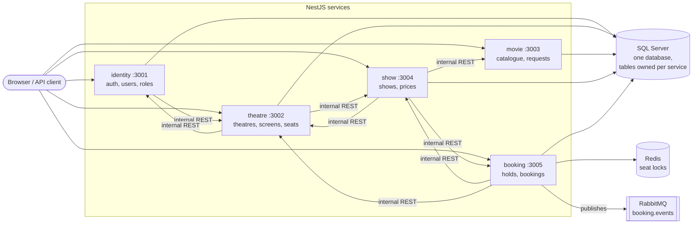

# Architecture overview

Five NestJS services in one npm-workspaces monorepo, two shared libraries, one SQL Server database with table ownership per service, Redis for seat locks and RabbitMQ for booking events. This page describes what the code does today; [`ROADMAP.md`](../ROADMAP.md) covers what is planned.

## Services

| Service | Port | Owns these tables | Responsibilities |
|---|---|---|---|
| identity | 3001 | `roles`, `users` | Login, token refresh, admin user management, temporary passwords |
| theatre | 3002 | `theatres`, `theatre_admins`, `screens`, `seats` | Theatres, screens, seats (bulk create and update), theatre-admin assignment |
| movie | 3003 | `movies`, `movie_images`, `movie_requests` | Movie catalogue, image URLs, theatre admins' movie requests and their review |
| show | 3004 | `shows`, `show_prices` | Show scheduling without overlaps, prices per seat type |
| booking | 3005 | `bookings`, `booking_seats`, `seat_holds` | Seat availability, holds, the booking state machine, expiry, internal transitions for payment |

Payment and notification services, and the guest-facing web app, do not exist yet.

## Shared libraries

- **`@moviebooking/common`**: start-up (`bootstrapService`: helmet, CORS, validation, error filter, Swagger outside production), JWT and role guards, the internal API guard, the service-to-service HTTP client, ID encryption, error codes.
- **`@moviebooking/database`**: TypeORM entities, enums, migrations, the shared connection factory, the booking state machine's transition table, and the seat-conflict repair command.

Services import the libraries through their compiled `dist/`, so the libraries are built first (`npm run build:libs`).

## How services talk to each other

**Synchronous REST on `/api/internal/*`.** Each service exposes internal routes on its normal port. Every internal route requires an `X-Internal-Key` header equal to `INTERNAL_API_KEY`, compared in constant time; a missing or wrong key gets 401. Each service refuses to start without the key. The shared client sends the key on every call, with a 2-second timeout. It returns `null` for a 404 and throws 503 for any other failure, so callers never confuse "does not exist" with "could not ask".

| Caller → callee | Why |
|---|---|
| identity → theatre | A theatre admin's assigned theatre, put into their access token at login and refresh |
| theatre → identity | Checking that a user is a theatre admin before assigning them |
| theatre → show | Refusing to deactivate a theatre or screen that has future shows |
| show → theatre, movie | Screen ownership, seat types for pricing, list enrichment |
| show → booking | Refusing to reschedule or delete a show that has bookings |
| booking → show, theatre | Show status, prices and the screen's seats when holding seats |

**Asynchronous events.** The booking service publishes `booking.confirmed`, `booking.expired` and `booking.failed` to the `booking.events` topic exchange, after the database transaction commits. No service consumes them yet.

## Shared database

All five services connect to one SQL Server database. Each service only maps the tables it owns, and no service joins across another service's tables at runtime. Foreign keys do cross the boundaries in the schema (for example `bookings.show_id` → `shows.id`). That keeps the data consistent, but it means the services cannot be deployed with separate databases yet; see [ADR 0010](adr/0010-shared-database.md).

## The booking flow

1. `GET /api/shows/:showId/seats/availability` (booking): every seat as AVAILABLE, HELD or SOLD, with its price.
2. `POST /api/bookings/hold`: Redis seat locks, then one transaction that reclaims expired holds on those seats, checks they are free and inserts the booking, its seats (with price and seat-code snapshots) and one ACTIVE hold per seat. The booking is HOLDING for 5 minutes.
3. `POST /api/internal/bookings/:ref/mark-payment-pending` (for the future payment service): PAYMENT_PENDING, with a deadline of 10 minutes from now but never more than 15 minutes from creation. The holds are extended to match.
4. `POST /api/internal/bookings/:ref/confirm`: CONFIRMED, holds become CONVERTED (the seats are sold), and `booking.confirmed` is published with the seat codes. A payment after the deadline goes to PENDING_REVIEW instead.
5. Anything overdue is expired by a sweep every minute, or earlier by the next hold request for the same seat.

The design decisions behind these steps are recorded in [`docs/adr/`](adr/).
